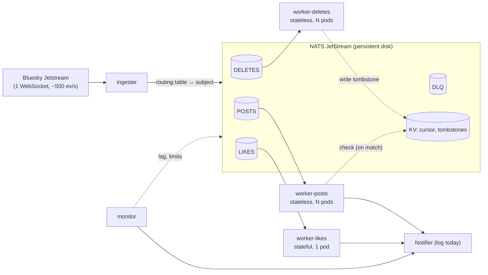

# Design: Bluesky event router

One ingest, many event types, fanned out to independent workers. This document covers the architecture, the
decisions behind it, the alternatives weighed, and the path to production.

## 1. Architecture

- **Ingester:** holds the single Jetstream connection, reads only `kind`, `commit.collection` and
  `commit.operation`, looks them up in the routing table, and publishes the original event to the matching NATS
  subject. It never talks to workers.
- **NATS JetStream:** one durable stream per path, plus a KV store for the resume cursor and tombstones.
- **Workers:** one Kubernetes Deployment per path, each reading only its own stream through one durable pull
  consumer shared by its replicas. All workers share one loop (fetch → handle → ack, retry, dead-letter); a path
  only implements `Handle(ctx, event) error`.
- **Monitor:** a separate pod that watches lag and stream limits and reports through the same `Notifier`
  interface the workers use (log lines today; Slack or a pager later).
- One Go binary and one image; the role is a flag (`ingester`, `worker --type=…`, `monitor`). All settings live in
  one `config.yaml` (a ConfigMap), validated at startup.

## 2. Routing

An ordered table in `internal/router`, checked top to bottom, **first match wins**:

| Match | Subject | Stream |
|---|---|---|
| `operation = delete`, any collection | `bsky.delete` | `DELETES` |
| `app.bsky.feed.post` / create | `bsky.post.create` | `POSTS` |
| `app.bsky.feed.like` / create | `bsky.like.create` | `LIKES` |
| `app.bsky.feed.repost` / create | `bsky.repost.create` | `LIKES` |

No match (follows, updates, identity/account) means drop and count. Deletes come first so every deletion goes to
one dedicated path. Adding a path is one row, one stream, one handler and one Deployment; nothing existing
changes. The `wantedCollections` server filter is derived from this table; it's empty today because the delete
route covers any collection.

## 3. Paths

| Path | Work | State |
|---|---|---|
| **Posts** | Match configured keywords (whole words) **or** languages; on a match, check for a tombstone, then alert with URI, author DID and matched rule, **never the text** | Stateless: scales by adding pods |
| **Likes** (likes + reposts) | One combined engagement count per target post over a rolling window; alert once when it crosses a threshold. Window and threshold are config | **Stateful**: one pod, counts in memory |
| **Deletes** | Write a tombstone (hashed record URI) to KV with a TTL ≥ the posts buffer | Stateless |

These three cover a stateless path, a stateful one, and routing on a different key (operation). Follows would
repeat the likes pattern, so it's described, not built.

- **Why likes is one pod:** a count needs every like for a post in one place; two pods would each see about half.
  Measured traffic is ~350 likes+reposts/s, a fraction of one pod's capacity, so one pod is both exact and enough.
- **Exact counts:** the window uses each event's own `time_us`, not the clock, so a lagging worker still counts
  correctly. Likes are deduped by URI. On restart the pod silently re-reads one window before its consumer's
  position, then continues; no duplicate alerts.
- **Metric definition:** "likes given in the window". A later unlike doesn't reduce it, so the likes path needs
  no tombstone lookup per like.
- **Tombstones** exist because creates and deletes travel on separate streams, so a delete can be processed
  first. The posts worker checks only on a match, which is one lookup per alert, not per post. If KV is
  unreachable it alerts anyway rather than block the path.

## 4. Isolation and backpressure

Each path has its own stream with limits (`MaxAge` 24h, `MaxBytes`) and `DiscardOld`. **The ingester never waits
for a worker**: a publish never fails because a stream is full, since NATS evicts that stream's oldest message
instead. A slow or dead path only grows its own backlog.

The tradeoff, stated plainly: with a path that stays slower than its input, you get only two of *limited disk*,
*no data loss*, and *paths that don't affect each other*. We chose limited disk + isolation, because the brief
centers on independent paths. Stalling the ingester at a full stream was rejected: it reads one ordered stream with
one cursor, so one slow path would stop every path.

What keeps loss rare and visible:
- Streams keep processed messages (limits retention) so likes can replay. The monitor therefore warns when a stream
  is near its limit **and** ≥80% of it is unprocessed, meaning eviction is about to reach unread messages.
- If eviction passes a consumer's position, the monitor reports `events lost: N` for that path only. It counts both
  messages evicted ahead of the consumer and those its next delivery jumped over (position moved further than the
  number of deliveries it received). Checked live against an independent count.
- On a laptop `MaxBytes` sets the buffer: measured ~5h for posts (1GB), ~2.4h for likes (2GB), ~13h for deletes;
  24h is the production target (the full firehose is ~28GB/day).

The slow-path demo (measured): with `process_delay: 50ms` on likes, the LIKES backlog grew 0 → 21k in 60s while POSTS
and DELETES stayed at 0 and the ingester never noticed. Back to 0 delay, it rebuilt its counts in ~0.1s, drained
the backlog at ~2.5k/s and was live again within 10s, with nothing lost.

## 5. Delivery guarantees

At-least-once, end to end.
- **Ingest:** async publish with at most 256 unconfirmed messages in flight. Live traffic is ~500/s but catch-up
  after an outage replays as fast as we can take it (measured: ~62k events/s through our ingester), and waiting on
  each ack caps out near 2k/s. The **cursor** (last `time_us` whose
  every earlier event is confirmed stored) is written to NATS KV every ~1s and on shutdown. It fails together with
  the broker, so the two can never disagree. If NATS is down, a publish not confirmed within `publish_timeout`
  stops the ingester, which resumes from the cursor; Jetstream's ~36h history is the buffer. An event over NATS's
  1MB message limit is skipped and counted, never retried forever.
- **Resume:** reconnect from the cursor. Verified live: an older cursor is silently clamped to ~36h, so the ingester
  compares its cursor with the first event received and logs a gap.
- **Dedupe:** NATS drops repeat message IDs (`did:time_us:collection:rkey`) within 2 minutes. (`did:time_us` alone
  isn't unique: one commit can write several records, such as a thread. Found on the live feed while building.)
  The likes worker dedupes deliveries by URI; every alert has a deterministic ID so receivers can drop repeats.
- **Failures:** a handler error is retried with backoff up to 5 deliveries, then the message is moved to `DLQ` and
  acked. A panic counts as a failed attempt. NATS's own delivery limit is set to twice that, as a backstop: if the
  dead-letter publish itself fails, the message is still redelivered rather than silently given up on. Workers ack only after the handler (including `Notify`) returns.
- **Shutdown:** the ingester drains in-flight publishes and saves the cursor; workers finish and ack the current
  message.

## 6. Scaling

| Component | Scales by | Limit and next step |
|---|---|---|
| Posts, deletes | Adding pods (shared pull consumer) | Autoscale on lag with KEDA |
| Likes | One pod by design | Move counting into NATS: a `LIKEWINDOW` stream copies likes per post subject with `MaxAge` = window, so a subject's message count is the rolling count; workers become stateless and autoscale |
| Ingester | Not horizontally (one ordered source; two readers duplicate) | ~20–50× headroom. Then parallel parsing in the pod, then several ingesters each owning some collections (gives up single ingest) |
| NATS | Fixed cluster | 3 nodes, each with its own disk, streams replicated |

## 7. Alternatives considered

| Decision | Chosen | Rejected and why |
|---|---|---|
| Fan-out | Broker + one Deployment per path | In-process goroutines/channels: queued events die with the process, paths can't fail or scale apart |
| Broker | NATS JetStream | Kafka: too heavy locally, the choice at much higher volume. Redis Streams: routing, reclaim and retries hand-written |
| Full stream | Evict oldest, per path | Stall the ingester: one slow path stops all |
| Likes scale-out | One exact pod; NATS counting as plan | Shard by post: can't autoscale. Redis `INCR` per like: a call per like, hot keys. Batched KV counters: approximate |
| Cursor | NATS KV | Local file: tied to one node, can disagree with the broker |
| Config | One YAML ConfigMap, applied on restart | Env vars: poor for lists. Hot reload: not worth it here |

## 8. Prototype → production

| Area | Built | Production |
|---|---|---|
| Broker | One NATS pod, one disk | 3-node cluster, replicated streams |
| Ingester | One pod | Warm standby with leader election; downtime alert before the 36h window |
| Data loss | Per-path buffer, loss reported | Autoscaling on lag; refill from Jetstream history; tiered storage (S3) instead of eviction |
| Notifications | Log line behind `Notifier` | Publish to `alerts.>` for Slack, review queues, webhooks; retries, rate limits |
| Observability | JSON logs, stats lines, NATS lag report, monitor | Prometheus, dashboards, alerting |
| Config | Restart to apply | Watch the mounted file and reload |
| Thresholds | Fixed engagement threshold | Relative to each target's baseline rate |

## 9. Assumptions and simplifications

- Jetstream v1 (`jetstream2.us-east`, named in the brief) with its `time_us` cursor; v2 hosts use a sequence cursor.
- Notifications are simulated as log lines. Alert receivers are expected to dedupe by alert ID.
- Engagement alerts fire once per burst: a target alerts again only after its likes have fully left the window.
  Smarter re-alerting (cooldowns, hysteresis) is left open.
- Demo window and threshold are small so alerts appear while watching; production values come from whoever consumes
  the alerts.
- Measured traffic: ~460–490 events/s (60s sample on 2026-10-23: likes 65%, reposts 11.5%, posts 11.5%, deletes 3%, unrouted 9% mostly follows). It varies through the day.
