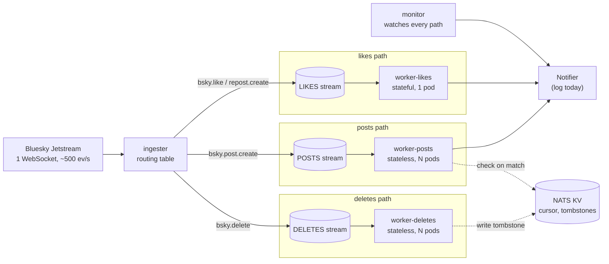

# Design: Bluesky event router

One ingest, many event types, fanned out to independent workers. This covers the architecture, the decisions
behind it, the alternatives weighed, what was verified, and the path to production.

## 1. Architecture

- **Ingester:** holds the single Jetstream connection, reads only `kind`, `commit.collection` and
  `commit.operation`, looks them up in the routing table, and publishes the original event to the matching NATS
  subject. It never talks to workers.
- **NATS JetStream:** one durable stream per path (each lane above), plus a KV store for the resume cursor and
  tombstones, and a dead-letter stream (`DLQ`).
- **Workers:** one Kubernetes Deployment per path, each reading only its own stream through one durable pull
  consumer shared by its replicas. All workers share one loop (fetch → handle → ack, retry, dead-letter); a path
  only implements `Handle(ctx, event) error`.
- **Monitor:** a separate pod that watches lag and stream limits and reports through the same `Notifier`
  interface as the workers (log lines today; Slack or a pager later).
- One Go binary and one image; the role is a flag. All settings live in one `config.yaml`, validated at startup
  (unknown keys and unsafe combinations fail loudly). On Kubernetes it's a ConfigMap; the ingester and likes worker
  use the `Recreate` strategy so an update never runs two at once.

## 2. Routing

An ordered table in `internal/router`, checked top to bottom, **first match wins**:

| Match | Subject | Stream |
|---|---|---|
| `operation = delete`, any collection | `bsky.delete` | `DELETES` |
| `app.bsky.feed.post` / create | `bsky.post.create` | `POSTS` |
| `app.bsky.feed.like` / create | `bsky.like.create` | `LIKES` |
| `app.bsky.feed.repost` / create | `bsky.repost.create` | `LIKES` |

No match (follows, updates, identity/account) means drop and count. Deletes come first so every deletion, of any
collection (including other apps on the protocol), goes to one dedicated path. Adding a path is one row, one stream,
one handler and one Deployment; nothing existing changes, and a test fails if a route has no stream. The
`wantedCollections` server filter is derived from the table; it's empty today because deletes cover any collection.

## 3. Paths

| Path | Work | State |
|---|---|---|
| **Posts** | Match configured keywords (whole words) **or** languages; on a match, check for a tombstone, then alert with URI, author DID and matched rule, **never the text** | Stateless: scales by adding pods |
| **Likes** (likes + reposts) | One combined engagement count per target post over a rolling window; alert once per burst when it crosses a threshold | **Stateful**: one pod, counts in memory |
| **Deletes** | Write a tombstone (hashed record URI) to KV with a TTL ≥ the posts buffer | Stateless |

These cover a stateless path, a stateful one, and routing on a different key. Follows would repeat the likes
pattern, so it's described, not built.

- **Why likes is one pod:** a count needs every like for a post in one place; two pods would each see about half.
  Traffic is ~350 likes+reposts/s, a fraction of one pod's capacity, so one pod is both exact and enough.
- **Exact counts:** the window uses each event's own `time_us`, not the clock, so a lagging worker still counts
  correctly, and likes are deduped by URI. On restart the pod re-reads one window before its consumer's position
  and rebuilds the counts silently (~0.1–0.5s), so no alert is sent twice.
- **Metric:** "likes given in the window". A later unlike doesn't reduce it, so no tombstone lookup per like.
- **Tombstones** exist because creates and deletes travel on separate streams, so a delete can be processed first.
  The posts worker checks only on a match (one lookup per alert, not per post), and alerts anyway if KV is down.

## 4. Isolation and backpressure

Each path has its own stream with limits (`MaxAge` 24h, `MaxBytes`) and `DiscardOld`. **The ingester never waits
for a worker**: a publish never fails because a stream is full, since NATS evicts that stream's oldest message
instead. A slow or dead path only grows its own backlog.

The tradeoff, stated plainly: with a path that stays slower than its input, you get only two of *limited disk*,
*no data loss*, and *paths that don't affect each other*. We chose limited disk + isolation, because the brief
centers on independent paths. Stalling the ingester at a full stream was rejected: it reads one ordered stream with
one cursor, so one slow path would stop every path.

What keeps loss rare and visible:
- Streams keep processed messages (limits retention) so likes can replay. The monitor therefore warns when a stream
  is near its limit **and** ≥80% of it is unread, meaning eviction is about to reach unread messages.
- If eviction passes a consumer, the monitor reports exactly how many messages that path lost: those evicted ahead
  of it and those its next delivery jumped over (its position moved further than the deliveries it received).
- On a laptop `MaxBytes` sets the buffer: ~5h for posts (1GB), ~2.4h for likes (2GB), ~13h for deletes. 24h is the
  production target (the full firehose is ~28GB/day).

## 5. Delivery guarantees

At-least-once, end to end.
- **Ingest:** async publish, at most 256 unconfirmed. Live traffic is ~500/s, but catch-up after an outage replays
  as fast as we take it (measured ~62k events/s), and waiting on each ack caps out near 2k/s. The **cursor** (last
  `time_us` with every earlier event confirmed stored) goes to NATS KV every second, so it fails together with the
  broker. If Jetstream drops us or NATS doesn't confirm within `publish_timeout`, the session ends and the ingester
  reconnects with backoff from the cursor; Jetstream's ~36h history is the buffer. An event over NATS's 1MB limit
  is skipped and counted rather than retried forever.
- **Resume:** an older cursor is silently clamped to ~36h (verified), so the ingester compares its cursor with the
  first event received and logs the gap.
- **Dedupe:** NATS drops repeat message IDs (`did:time_us:collection:rkey`) within 2 minutes. `did:time_us` alone
  isn't unique: one commit can write several records, such as a thread (found on the live feed). Likes dedupe by
  URI; every alert has a deterministic ID so receivers can drop repeats.
- **Failures:** a handler error is retried with backoff; after 5 attempts the message goes to `DLQ` with the error
  and attempt count in headers. Unparseable events go there on the first attempt. A panic is a failed attempt, not
  a dead pod. NATS's own delivery limit is twice ours, so a failed dead-letter publish is still retried.
- **Shutdown:** the ingester saves its confirmed cursor; anything unconfirmed is resent on the next start and
  deduped. Workers stop fetching; messages they had pulled but not acked are redelivered after `ack_wait` (30s).
  Nothing is lost, only delayed.

## 6. Scaling

| Component | Scales by | Limit and next step |
|---|---|---|
| Posts, deletes | Adding pods (shared pull consumer) | Autoscale on lag with KEDA |
| Likes | One pod by design | **Hash partitions, like Kafka:** the ingester sends each like to `bsky.like.create.<hash(post) % N>`; a StatefulSet runs N likes pods (`likes-0`…), each reading only its partition and counting its posts exactly. Changing N moves posts between pods, which rebuild by replaying the window (~0.3s with a 1-minute window) |
| Ingester | Not horizontally (one ordered source; two readers duplicate) | Large headroom. Then parallel parsing in the pod, then several ingesters each owning some collections (gives up single ingest) |
| NATS | Fixed cluster | 3 nodes, each with its own disk, streams replicated |

## 7. Alternatives considered

| Decision | Chosen | Rejected and why |
|---|---|---|
| Fan-out | Broker + one Deployment per path | In-process goroutines/channels: queued events die with the process, paths can't fail or scale apart |
| Broker | NATS JetStream | Kafka: too heavy locally, the choice at much higher volume. Redis Streams: routing, reclaim and retries hand-written |
| Full stream | Evict oldest, per path | Stall the ingester: one slow path stops all |
| Likes scale-out | One exact pod; hash partitions by post as the plan | Counting inside NATS (a per-post stream keeping one window): fully elastic, but more custom code and a count query per post per second. Redis `INCR` per like: a call per like, hot keys. Batched KV counters: approximate |
| Cursor | NATS KV | Local file: tied to one node, can disagree with the broker |
| Config | One YAML, applied on restart | Env vars: poor for lists. Hot reload: not worth it here |

## 8. How it was verified

- **Tests** (Go, `go test -race ./...`): the routing table; the likes window (rolling, event time, once per burst,
  duplicates); the worker loop against a real NATS (retry, dead-letter, panic, garbage, good messages flowing
  past bad ones); the monitor's warning and loss arithmetic; config rules; and a regression test for an ingester
  freeze. Regression tests were checked to fail with the bug put back.
- **Live, against the real feed:** a slowed likes worker grew only the LIKES backlog (0 → 21k in 60s) while posts
  and deletes stayed at 0, then caught up within 10s with nothing lost; a 20s NATS outage was survived by every
  role; a worker killed with SIGKILL had exactly its unacked messages redelivered; two replicas split the work
  evenly; a reported loss count matched an independent count.
- **Bugs found this way:** thread posts dropped as duplicates; the ingester freezing silently when NATS went down
  (the client's async publish has no timeout by default); a 44s likes replay; a loss count 5× too low; a message
  stuck forever if its dead-letter publish failed.

## 9. Where I stopped, and production

| Area | Built | Described only (production) |
|---|---|---|
| Paths | Posts, likes/reposts, deletes | Follows (same shape as likes), identity/account (routing on `kind`) |
| Broker | One NATS pod, one disk | 3-node cluster, replicated streams |
| Ingester | One pod, reconnect from cursor | Warm standby with leader election; alert before downtime reaches 36h |
| Data loss | Per-path buffer, warning, exact loss report | Autoscaling on lag; refill from Jetstream history; tiered storage (S3) |
| Shutdown, health | Cursor saved; unfinished work redelivered | Drain in-flight work on SIGTERM; liveness probe on a loop heartbeat |
| Notifications | Log line behind `Notifier` | Publish to `alerts.>` for Slack, review queues, webhooks |
| Observability | JSON logs, stats lines, NATS lag report, monitor | Prometheus, dashboards, alerting |
| Config, thresholds | Restart to apply; fixed threshold | Reload on change; threshold relative to each target's baseline |

Assumptions: Jetstream v1 (`jetstream2.us-east`, named in the brief) with its `time_us` cursor; demo window and
threshold are small so alerts appear while watching; engagement alerts fire once per burst (smarter re-alerting is
open); measured traffic is ~460–490 events/s (likes 65%, reposts 11.5%, posts 11.5%, deletes 3%) and varies
through the day.
